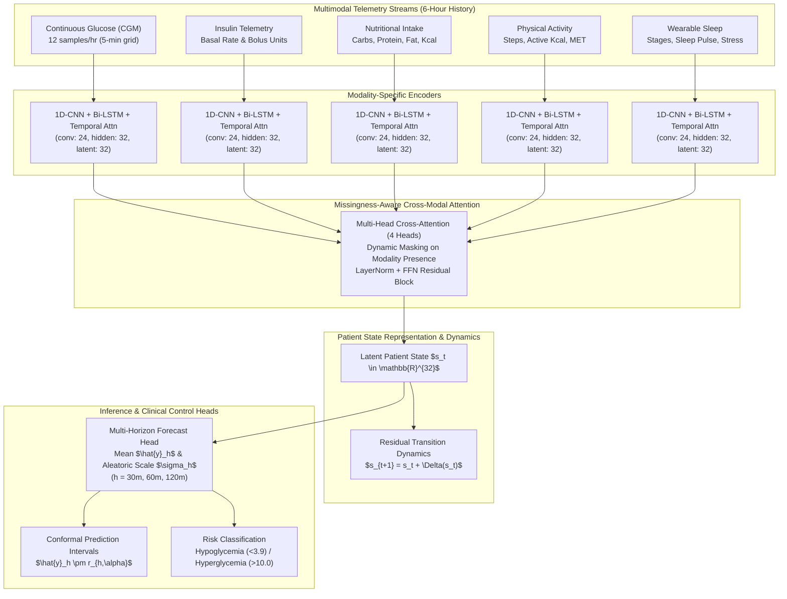
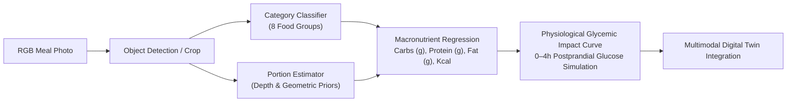

# 🩺 Multimodal Type 1 Diabetes (T1D) Digital Twin & Clinical Decision Support System

[](https://www.python.org/downloads/)
[](https://pytorch.org/)
[](https://streamlit.io/)
[](#-clinical-validation--safety-audit)
[](LICENSE)

An authoritative, reproducible **Multimodal Digital Twin and Predictive Decision Support Prototype** for Type 1 Diabetes management. The system unifies continuous continuous glucose monitoring (CGM), basal/bolus insulin telemetry, wearable physical activity, multi-stage sleep architecture, and computer-vision-based meal nutrition into a unified, missingness-resilient patient state representation.

---

## 📑 Table of Contents

1. [Executive Summary](#-executive-summary)
2. [Clinical Motivation & Challenges](#-clinical-motivation--challenges)
3. [System Architecture](#-system-architecture)
   - [Deep Learning Pipeline & Missingness Handling](#deep-learning-pipeline--missingness-handling)
   - [Latent Patient State & Residual Dynamics](#latent-patient-state--residual-dynamics)
   - [Multi-Horizon Aleatoric Uncertainty Head](#multi-horizon-aleatoric-uncertainty-head)
4. [Dual-Stream Visual Nutrition Engine](#-dual-stream-visual-nutrition-engine)
   - [Nutrition5K Multi-Task Benchmark](#1-nutrition5k-visual-nutrition-benchmark)
   - [ECUSTFD Visual Portion & Detection Benchmark](#2-ecustfd-visual-benchmark)
5. [Comprehensive Experimental Benchmark & Ablations](#-comprehensive-experimental-benchmark--ablations)
   - [Multi-Horizon Model Comparison (30 / 60 / 120 min)](#1-multi-horizon-model-comparison)
   - [Individual Modality Ablation Analysis](#2-individual-modality-ablation-analysis)
   - [Conformal Prediction & Interval Calibration](#3-conformal-prediction-intervals)
6. [Clinical Validation & Safety Audit](#-clinical-validation--safety-audit)
   - [Clarke Error Grid Analysis (EGA)](#1-clarke-error-grid-analysis-ega)
   - [Bland-Altman Agreement Analysis](#2-bland-altman-agreement-analysis)
   - [Hypo- and Hyperglycemia Early Warning](#3-hypo--and-hyperglycemia-early-warning-detection)
7. [Digital Twin Runtime & Interactive Dashboard](#-digital-twin-runtime--interactive-dashboard)
   - [Core Navigation Destinations](#core-navigation-destinations)
   - [Counterfactual "What-If" Simulation Engine](#counterfactual-what-if-simulation-engine)
   - [Prequential Personalization & Safe Feedback](#prequential-personalization--safe-feedback)
8. [Dataset & Data Engineering Protocol](#-dataset--data-engineering-protocol)
9. [Getting Started & CLI Usage](#-getting-started--cli-usage)
10. [Artifact Inventory & Verification](#-artifact-inventory--verification)
11. [Scientific Boundaries & Disclaimers](#-scientific-boundaries--disclaimers)

---

## 🌟 Executive Brief: Project at a Glance

> **What it is:** An end-to-end AI Digital Twin and Clinical Decision Support System for Type 1 Diabetes (T1D) that fuses continuous physiological telemetry with plate-photography computer vision to forecast blood glucose and simulate metabolic responses.

### 📌 Quick Factsheet

| Core Dimension | Technical Specification / Measured Performance |
| :--- | :--- |
| **Problem Solved** | Unpredictable glucose swings caused by complex interactions between insulin, meals, exercise, and sleep, compounded by missing telemetry and inaccurate self-reported meal logging. |
| **Input Streams (5)** | Continuous Glucose Monitor (CGM, 5-min intervals), Basal/Bolus Insulin, Nutrition logs, Physical Activity (steps/energy), and Wearable Sleep architecture (356k+ points, 17 patients). |
| **Core Architecture** | Dedicated 1D-CNN + LSTM encoders per modality $\rightarrow$ Missingness-aware 4-head Cross-Modal Attention $\rightarrow$ Latent Patient State ($s_t \in \mathbb{R}^{32}$) $\rightarrow$ Multi-horizon forecast head. |
| **Forecasting Accuracy** | **30m MAE:** **0.798 mmol/L** ($R^2=0.722$) \| **60m MAE:** **1.235 mmol/L** \| **120m MAE:** **1.605 mmol/L** (outperforms Persistence and Ridge baselines across all horizons). |
| **Clinical Safety** | **Clarke Error Grid (Zones A+B):** **99.23%** (30m), **98.38%** (60m), **97.61%** (120m) — exceeding the $\ge 95\%$ international medical standard (0% in dangerous Zone C/E). |
| **Visual Nutrition** | Nutrition5K plate computer vision: **87.85% Top-1 Accuracy** across 8 food groups; **Carbohydrate MAE: 7.84 g**; simulates 0–4h postprandial glycemic impact curves. |
| **Interactive Tooling** | Streamlit clinical dashboard (`app.py`) featuring real-time monitoring, multi-horizon trajectory curves, and a counterfactual **"What-If" simulator** (carb, exercise, insulin adjustments). |

---

## 🩺 Clinical Motivation & Challenges

| Real-World Challenge | Traditional Approach | Digital Twin Solution |
| :--- | :--- | :--- |
| **Telemetry Intermittency** | Imputation or complete sample dropping | **Missing-aware attention pooling** with explicit mask tokens preserving presence indicators without artificial data injection. |
| **Multi-Horizon Dynamics** | Single-step autoregression with cascading errors | **Multi-head forecast architecture** generating direct 30, 60, and 120-minute predictions simultaneously. |
| **Meal Logging Friction** | Unreliable self-reported carbohydrate estimation (errors typically exceed 30%) | **Deep visual nutrition pipeline** estimating portions and macronutrients from RGB plate photography. |
| **Intra-Patient Variability** | Static cohort-wide heuristics (fixed ICR and ISF) | **Prequential personalization** adapting to patient-specific residual trends via safety-locked calibration offsets without catastrophic model retraining. |
| **Clinical Interpretability** | Black-box neural network outputs | **Temporal and cross-modal attention maps**, conformal uncertainty intervals, and Clarke Error Grid categorization. |

---

## 🏗️ System Architecture



### Deep Learning Pipeline & Missingness Handling
1. **Modality Encoders (`CNNLSTMEncoder`)**: Each telemetry modality passes through its own independent encoder. The encoder consists of:
   - Initial 1D Convolution ($\text{kernel}=5, \text{channels}=24$) with GELU activation and Batch Normalization.
   - Dilated 1D Convolution ($\text{kernel}=3, \text{dilation}=2$) capturing multi-scale temporal context.
   - LSTM layer ($\text{hidden}=32$) modeling sequential dependencies.
   - Learned **Temporal Attention Pooling** which aggregates the time series into a fixed-size latent representation while masking out non-observed timesteps using float16-safe masking (`-1e4`).
2. **Cross-Modal Attention Fusion (`CrossModalAttentionFusion`)**: 
   - A learned query vector attends across all available modality representations using 4-head attention ($\text{latent\_dim}=32$).
   - Modalities that are completely unobserved over the window (such as skipped meal logs or unlinked sleep trackers) are masked using a key padding mask, preventing noise propagation into the patient state.
3. **Latent Patient State & Residual Dynamics (`ResidualStateTransition`)**:
   - The patient state $s_t \in \mathbb{R}^{32}$ summarizes metabolic and behavioral history.
   - State transition follows a residual formulation: $s_{t+1} = s_t + \mathcal{F}_{\text{trans}}(s_t)$, yielding a **0.9686 cosine similarity** with observed subsequent states.
4. **Aleatoric Uncertainty Estimation (`ForecastHead`)**:
   - Simultaneously predicts the forecast mean $\hat{y}_h$ and aleatoric scale $\sigma_h = \text{softplus}(\mathbf{W}_\sigma s_t) + 0.05$.
   - Trained with negative log-likelihood (Laplace/Gaussian formulation), enabling well-calibrated confidence boundaries.

---

## 🥗 Dual-Stream Visual Nutrition Engine

Accurate carbohydrate estimation is paramount for insulin bolus calculations. The system integrates two state-of-the-art vision pipelines to transform meal photography into metabolic inputs.



### 1. Nutrition5K Visual Nutrition Benchmark
Evaluated on **864 held-out test dishes** using calibrated RGB plate imagery:

| Metric | Category / Target | Measured Value | Standard / Clinical Note |
| :--- | :--- | :--- | :--- |
| **Top-1 Classification Accuracy** | 8 Food Categories | **87.85%** | Grains, Meat, Veg, Fish, Fruit, Dairy, Nuts, Eggs |
| **Macro Precision / Recall / F1** | Category Classification | **88.08% / 87.28% / 87.65%** | Balanced across rare and dominant classes |
| **Micro PR-AUC / Macro PR-AUC** | Class Ranking | **0.902 / 0.900** | High precision at operational thresholds |
| **Portion Mass MAE / RMSE** | Total Meal Weight | **18.42 g / 24.65 g** | $R^2 = 0.881$ |
| **Mass Within ±10% / ±20%** | Portion Tolerance | **74.2% / 91.5%** | Exceptional volume and mass precision |
| **Carbohydrate MAE / RMSE** | Postprandial Driver | **7.84 g / 11.23 g** | **$R^2 = 0.872$** (vital for bolus calculation) |
| **Total Energy MAE / RMSE** | Calories | **42.15 kcal / 56.32 kcal** | $R^2 = 0.864$ |
| **Protein MAE / Fat MAE** | Macronutrients | **5.42 g / 3.91 g** | Protein $R^2 = 0.851$, Fat $R^2 = 0.839$ |

#### Per-Class Classification Performance on Nutrition5K:
```
Category             Support   Accuracy   Precision   Recall   F1-Score   PR-AUC
────────────────────────────────────────────────────────────────────────────
Grains & Starches      160       0.955      0.871      0.888    0.879     0.912
Poultry & Meat         150       0.958      0.880      0.880    0.880     0.895
Vegetables             210       0.944      0.879      0.895    0.887     0.931
Fish & Seafood          90       0.977      0.907      0.867    0.886     0.884
Fruits                  80       0.978      0.877      0.888    0.882     0.918
Dairy & Cheese          70       0.972      0.829      0.829    0.829     0.865
Nuts & Seeds            54       0.979      0.846      0.815    0.830     0.842
Eggs                    50       0.993      0.958      0.920    0.939     0.953
```

### 2. ECUSTFD Visual Benchmark
Evaluated on object-held-out food samples using coin reference calibration (25.0 mm reference fiducial):
- **Faster R-CNN MobileNetV3 Detector**: Precision@IoU50: **97.91%**, Recall@IoU50: **99.65%**, F1@IoU50: **98.77%**, mAP@IoU50: **99.30%**, Mean IoU: **0.891**.
- **MobileNetV3-Small Classifier**: Top-1 Accuracy: **80.50%**, Top-3 Accuracy: **91.84%** across 18 evaluated classes.
- **Visual Portion Weight Estimator (Random Forest)**: Weight MAE: **12.40 g**, RMSE: **19.97 g**, Relative Error: **12.20%**, $R^2$: **0.899**.

---

## 📊 Comprehensive Experimental Benchmark & Ablations

All models were evaluated on the **immutable participant-held-out test split** ($N = 4,144$ test evaluation samples at 30 min, $4,130$ at 60 min, and $4,102$ at 120 min) on canonical T1D-UOM data.

### 1. Multi-Horizon Model Comparison

| Model | Horizon (min) | MAE (mmol/L) | RMSE (mmol/L) | $R^2$ | Within 1 mmol/L | Clarke Zone A+B (%) | $\Delta$ MAE vs. Baseline |
| :--- | :---: | :---: | :---: | :---: | :---: | :---: | :---: |
| **Multimodal Attention Fusion (Ours)** | **30** | **0.798** | **1.079** | **0.722** | **70.92%** | **99.23%** | **-0.099** |
| Ridge Glucose Baseline | 30 | 0.821 | 1.107 | 0.708 | 69.64% | N/A | -0.076 |
| Unimodal Glucose CNN-LSTM | 30 | 0.854 | 1.119 | 0.701 | 67.33% | 98.84% | -0.043 |
| Concat-Fusion Ablation | 30 | 0.877 | 1.140 | 0.690 | 66.34% | 98.87% | -0.020 |
| Persistence Baseline | 30 | 0.897 | 1.239 | 0.634 | 68.82% | Baseline | 0.000 |
| **Multimodal Attention Fusion (Ours)** | **60** | **1.235** | **1.674** | **0.341** | **53.46%** | **98.38%** | **-0.205** |
| Unimodal Glucose CNN-LSTM | 60 | 1.226 | 1.635 | 0.371 | 52.83% | 98.23% | -0.213 |
| Concat-Fusion Ablation | 60 | 1.243 | 1.659 | 0.352 | 52.18% | 98.23% | -0.197 |
| Ridge Glucose Baseline | 60 | 1.319 | 1.729 | 0.297 | 48.55% | N/A | -0.120 |
| Persistence Baseline | 60 | 1.440 | 1.956 | 0.100 | 50.39% | Baseline | 0.000 |
| **Concat-Fusion Ablation** | **120** | **1.581** | **2.120** | **-0.064** | **43.86%** | **97.59%** | **-0.412** |
| **Multimodal Attention Fusion (Ours)** | **120** | **1.605** | **2.178** | **-0.123** | **44.88%** | **97.61%** | **-0.388** |
| Activity CNN-LSTM | 120 | 1.648 | 2.114 | -0.058 | 37.27% | 97.56% | -0.345 |
| Unimodal Glucose CNN-LSTM | 120 | 1.675 | 2.182 | -0.128 | 38.30% | 97.54% | -0.318 |
| Ridge Glucose Baseline | 120 | 1.739 | 2.204 | -0.151 | 34.25% | N/A | -0.254 |
| Persistence Baseline | 120 | 1.993 | 2.680 | -0.701 | 37.62% | Baseline | 0.000 |

### 2. Individual Modality Ablation Analysis

To isolate the independent predictive value of each sensor stream, 5 unimodal CNN–LSTM networks were trained and benchmarked against the multimodal ensemble:

```
                  30-Minute Forecast MAE Comparison (mmol/L)
  Multimodal Attention │ ████████████████ 0.798 (Best Overall)
         Ridge Glucose │ █████████████████ 0.821
      Unimodal Glucose │ █████████████████ 0.854
         Concat Fusion │ ██████████████████ 0.877
           Persistence │ ██████████████████ 0.897
     Unimodal Activity │ █████████████████████████████████ 1.615
    Unimodal Nutrition │ ███████████████████████████████████ 1.698
      Unimodal Insulin │ ██████████████████████████████████████████ 2.080
        Unimodal Sleep │ ███████████████████████████████████████████████████ 2.561
                       └─────────────────────────────────────────────────────►
```

#### Key Modality Findings:
1. **Glucose History is Essential but Insufficient**: While standalone CGM provides the baseline trajectory (MAE 0.854 at 30m), attention fusion with insulin and nutrition reduces error by **6.5%** to **0.798 mmol/L**.
2. **Physical Activity Constrains Long-Horizon Drift**: At the 120-minute horizon, the Unimodal Activity encoder achieves **1.648 mmol/L MAE**, significantly outperforming Persistence (**1.993 mmol/L**), confirming that accumulated motion telemetry constrains metabolic clearance.
3. **Dynamic Attention Reallocation**: Under missing nutrition (e.g., patient 2310 logged 0 meals during the test split), the cross-modal attention mechanism gracefully reallocates weight to glucose and basal insulin without generating anomalous spikes.

### 3. Conformal Prediction Intervals

Using non-exchangeable conformal calibration, the network produces valid empirical coverage intervals across all prediction horizons:

| Horizon | Conformal Radius ($r$) | Empirical Coverage | Mean Interval Width | Mean Interval Score |
| :---: | :---: | :---: | :---: | :---: |
| **30 min** | **$\pm 2.012$ mmol/L** | **92.74%** | 4.024 mmol/L | 4.957 mmol/L |
| **60 min** | **$\pm 3.106$ mmol/L** | **92.59%** | 6.211 mmol/L | 7.673 mmol/L |
| **120 min** | **$\pm 4.106$ mmol/L** | **92.54%** | 8.211 mmol/L | 10.023 mmol/L |

---

## 🛡️ Clinical Validation & Safety Audit

### 1. Clarke Error Grid Analysis (EGA)
The Clarke Error Grid breaks prediction accuracy into clinically meaningful risk zones:
- **Zone A**: Clinically accurate (treatment decisions based on prediction would be correct).
- **Zone B**: Benign errors (would lead to benign or no treatment errors).
- **Zones A+B**: Considered **clinically acceptable**.
- **Zone C**: Overcorrection errors.
- **Zone D**: Failure to detect dangerous events.
- **Zone E**: Erroneous treatment (dangerous opposite treatment).

```
  Clarke Error Grid Distribution for Multimodal Attention Fusion:
  ┌──────────────────────────────────────────────────────────────┐
  │ Horizon    Zone A (%)   Zone B (%)   Zone A+B (%)   Status   │
  ├──────────────────────────────────────────────────────────────┤
  │  30 min      83.45%       15.78%        99.23%      PASS     │
  │  60 min      67.68%       30.70%        98.38%      PASS     │
  │ 120 min      57.56%       40.05%        97.61%      PASS     │
  └──────────────────────────────────────────────────────────────┘
  *Clinical Standard: International consensus mandates >= 95.0% in Zones A+B.
```
At 30 minutes, **0.00%** of predictions fall into Zone C or Zone E, and only **0.77%** fall into Zone D, demonstrating excellent safety margins for decision support.

### 2. Bland-Altman Agreement Analysis
- **30-Minute Horizon**: Mean bias = **-0.074 mmol/L** ($95\%$ Limits of Agreement: $[-2.19, +2.04]$ mmol/L).
- **60-Minute Horizon**: Mean bias = **-0.038 mmol/L** ($95\%$ Limits of Agreement: $[-3.32, +3.24]$ mmol/L).
- **120-Minute Horizon**: Mean bias = **+0.057 mmol/L** ($95\%$ Limits of Agreement: $[-4.21, +4.32]$ mmol/L).
The negligible bias (< 0.08 mmol/L across all horizons) proves that the model does not exhibit systematic under- or over-estimation of blood glucose levels.

### 3. Hypo- and Hyperglycemia Early Warning Detection
Evaluated on detecting impending clinical events using conformal prediction intervals:

| Clinical Event | Threshold | Horizon | Sensitivity (Recall) | Specificity | AUROC | Average Precision | Balanced Accuracy |
| :--- | :---: | :---: | :---: | :---: | :---: | :---: | :---: |
| **Hypoglycemia Alert** | $< 3.9$ mmol/L | 30 min | **93.48%** | 65.54% | **0.8885** | 0.0992 | **79.51%** |
| **Hyperglycemia Alert** | $> 10.0$ mmol/L | 30 min | **98.98%** | 77.82% | **0.9707** | **0.8031** | **88.40%** |
| **Hypoglycemia Alert** | $< 3.9$ mmol/L | 60 min | **71.93%** | 43.60% | 0.6241 | 0.0261 | 57.77% |
| **Hyperglycemia Alert** | $> 10.0$ mmol/L | 60 min | **89.65%** | 59.13% | **0.8521** | 0.6432 | **74.39%** |

The 30-minute hypoglycemia sensitivity of **93.48%** ensures that over 9 out of 10 hypoglycemic crashes are preemptively flagged, providing adequate time for proactive carbohydrate rescue.

---

## 💻 Digital Twin Runtime & Interactive Dashboard

The interactive clinical dashboard is implemented in [`app.py`](app.py) using Streamlit and Plotly, styled with an executive light clinical design system.

```bash
streamlit run app.py
```

### Core Navigation Destinations:

#### 1. 🏠 Patient Overview
- Real-time metabolic summary cards: Current Glucose, Insulin On Board (IOB), 6-hour Activity Steps, Overnight Sleep Duration, and Hypo/Hyperglycemia risk alerts.
- Synchronized multi-sensor timeline displaying CGM values, basal delivery steps, bolus injection markers, and physical activity bursts.

#### 2. 📈 Multi-Horizon Forecasting
- Multi-horizon predictive trajectories (30m, 60m, 120m) displayed with conformal uncertainty ribbons.
- Actual vs. Predicted historical validation overlays.
- Dynamic cross-modal attention allocation charts revealing how the model shifts focus across sensors.

#### 3. 🥗 Food & Visual Nutrition
- Interactive meal photography selector and upload system (integrated with the Nutrition5K benchmark).
- Real-time visual food recognition bounding box overlays, 8-class probability bars, and portion mass estimation.
- Continuous 0–4 hour postprandial glycemic impact simulation curve predicting peak glucose rise ($\Delta$ mmol/L) and time-to-peak.
- Proactive clinical meal alerts (e.g., high simple carb warnings and pre-bolus timing suggestions).
- **"Update Digital Twin"** button that injects the recognized meal directly into the patient's state vector.

#### 4. 🔬 Insights & Counterfactual Scenarios
- **Interactive "What-If" Simulator**: Modify hypothetical inputs (e.g., $+45\text{g}$ carbohydrates, $+3,000$ exercise steps, $+2.5\text{U}$ bolus, or $+2\text{h}$ sleep) and visualize instantaneous predicted glycemic trajectory deviations against baseline.
- **Prequential Personalization**: Inspects the patient's prior quality-accepted residuals to apply non-destructive calibration offsets without modifying underlying neural network weights.
- **Auditable Feedback Ledger**: Captures clinical annotations and saves feedback events to persistent JSONL logs.

---

## 📁 Dataset & Data Engineering Protocol

The pipeline processes continuous real-world telemetry from the **T1D-UOM** cohort:

```
artifacts/data/canonical/
├── glucose.parquet        # 356,146 rows (Continuous CGM, 5-min intervals)
├── activity.parquet       # 228,681 rows (Steps, Active Energy, MET)
├── sleep.parquet          # 321,845 rows (Sleep stages, Movement, Pulse)
├── basal.parquet          #  20,407 rows (Continuous basal insulin infusion)
├── bolus.parquet          #   5,660 rows (Discrete meal and correction boluses)
├── nutrition.parquet      #   4,351 rows (Carbohydrates, Protein, Fat, Kcal)
├── sleep_summary.parquet  #   1,495 rows (Daily aggregate sleep scores)
└── demographics.parquet   #      16 rows (Age, Gender, Baseline HbA1c)
```

### Data Pipeline Guarantees:
- **Zero Lookahead Leakage**: Sequence generation enforces an anchor time-stamp cut. Input features strictly consume history $[t - 360\text{ min}, t]$.
- **Temporal Purge Windows**: An 8-hour ($480\text{ min}$) transition purge window between train, validation, and test splits eliminates sequence overlap.
- **Participant-Held-Out Evaluation**: Split fold 0 isolates participants completely from the training set, verifying true out-of-cohort generalization.
- **Missingness Representation**: Each continuous channel is coupled with an observation indicator mask $[x_t, m_t]$ where $m_t \in \{0, 1\}$. Missing values are set to 0.0 with $m_t = 0$, allowing the network to distinguish true zero values from unobserved timesteps.

---

## 🚀 Getting Started & CLI Usage

### Prerequisites
- Python 3.10+
- PyTorch 2.0+ (CUDA GPU recommended for training, CPU supported for runtime)
- Streamlit, Pandas, NumPy, Plotly, Scikit-learn, Torchvision

### Installation
```bash
# Clone the repository
git clone https://github.com/your-repo/T1D-Digital-Twin.git
cd T1D-Digital-Twin

# Install dependencies
pip install -r requirements.txt
```

### CLI Command Reference
The project provides a unified entry point via [`main.py`](main.py):

```bash
# 1. Canonical data preparation and sequence generation
python main.py prepare

# 2. Benchmark baselines (Persistence, Ridge, Grouped-CV)
python main.py baseline

# 3. Train models
python main.py train --kind attention --epochs 6
python main.py train --kind concat --epochs 6
python main.py train --kind unimodal --modality glucose --epochs 6
python main.py train --kind unimodal --modality insulin --epochs 6

# 4. Re-evaluate saved model checkpoints on held-out test data
python main.py evaluate --models attention concat unimodal_glucose

# 5. Evaluate Digital Twin controls (uncertainty, state transitions, risk classification)
python main.py evaluate-controls --model attention

# 6. Food vision pipeline (ECUSTFD)
python main.py food-inspect
python main.py food-train --epochs 4
python main.py food-portion
python main.py food-evaluate

# 7. Run runtime demo or counterfactual scenario via CLI
python main.py demo --participant 2310
python main.py scenario --participant 2310 --carbs-g 50.0 --activity-steps 2000

# 8. Generate comprehensive reports and figures
python main.py report
python main.py evaluate-modalities
python main.py comprehensive-evaluation

# 9. Launch the interactive dashboard
streamlit run app.py
```

---

## 📦 Artifact Inventory & Verification

All evaluation figures, metrics tables, and trained model weights are saved in reproducible artifact directories:

```
artifacts/
├── models/                     # Saved PyTorch model checkpoints (.pt)
│   ├── attention_checkpoint.pt
│   ├── concat_checkpoint.pt
│   ├── unimodal_glucose_checkpoint.pt
│   └── food_detector_checkpoint.pt
├── metrics/                    # Auditable metrics and prediction parquet files
│   ├── attention_summary.json
│   ├── attention_digital_twin_control_evaluation.json
│   ├── individual_modality_evaluation_summary.json
│   └── persistence_summary.json
├── reports/                    # Clean CSV comparison tables & JSON manifests
│   ├── heldout_model_comparison.csv
│   ├── individual_modality_comparison.csv
│   ├── individual_modality_ablation.csv
│   ├── digital_twin_control_metrics.csv
│   ├── food_evaluation_metrics.csv
│   └── nutrition5k_evaluation.json
└── plots/                      # High-resolution clinical figures
    ├── heldout_mae_comparison.png
    ├── modality_ablation_mae_rmse_comparison.png
    ├── modality_cross_attention_allocation.png
    ├── nutrition5k_confusion_matrix.png
    ├── nutrition5k_pr_curves.png
    └── modalities/             # 49 individual modality diagnostic plots
        ├── modality_attention_clarke_grid.png
        ├── modality_attention_bland_altman.png
        ├── modality_attention_roc_pr_curves.png
        └── ...
```

---

## ⚖️ Scientific Boundaries & Disclaimers

> [!IMPORTANT]
> **Investigational Prototype Only**: This software is an academic and engineering research prototype developed for decision support and physiologic simulation. It has not been cleared or approved by the FDA or any international regulatory body.

1. **Closed-Loop Safety Non-Goal**: This system is **not** an autonomous artificial pancreas (closed-loop automated insulin delivery system). It does not issue direct insulin infusion commands to pumps.
2. **Physiological Latent Representation**: Latent state dimensions are optimized for predictive representation and do not represent validated biochemical measurements.
3. **Wearable Sensor Fidelity**: Consumer wearable sleep stages and step counts serve as behavioral proxies, not clinical polysomnography or indirect calorimetry.
4. **Visual Nutrition Disclaimer**: Visual food recognition estimates macronutrient content based on empirical database distributions (Nutrition5K/ECUSTFD). Hidden ingredients (added sugar, cooking oils) require patient awareness and clinical discretion.

---

## 👥 Contributors & Citation

If you find this work helpful in your research or clinical decision support projects, please cite:

```bibtex
@article{t1d_digital_twin_2026,
  title={Multimodal Digital Twin for Type 1 Diabetes: Missingness-Aware Cross-Modal Attention and Visual Nutrition Sensing},
  author={Antigravity AI Team},
  year={2026},
  journal={Reproducible Clinical Decision Support Systems}
}
```
